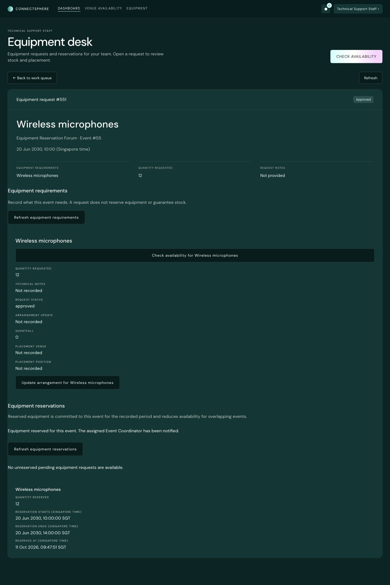
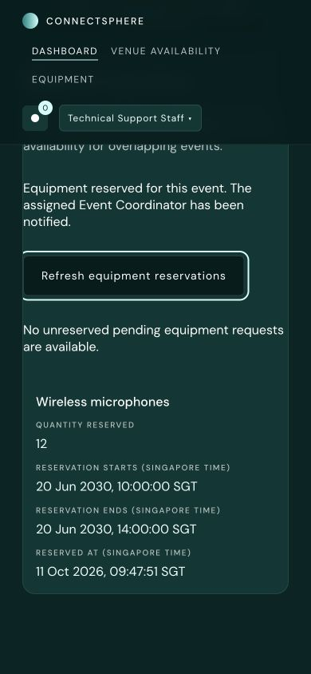
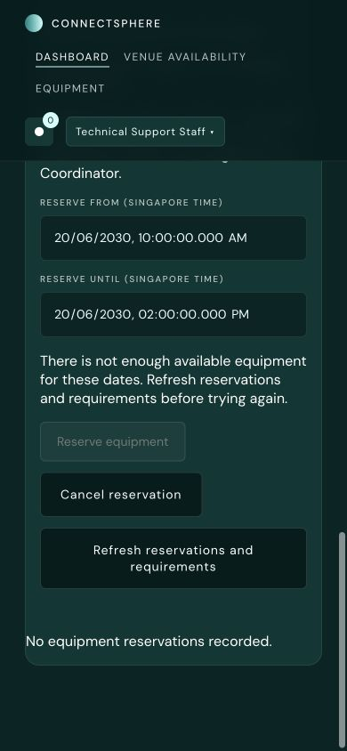
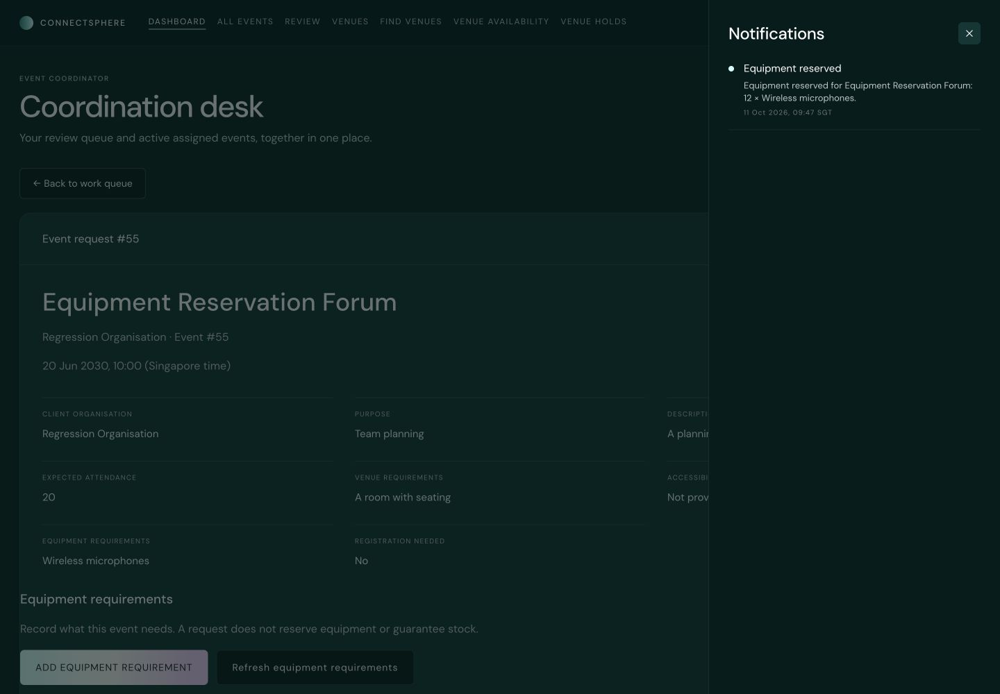
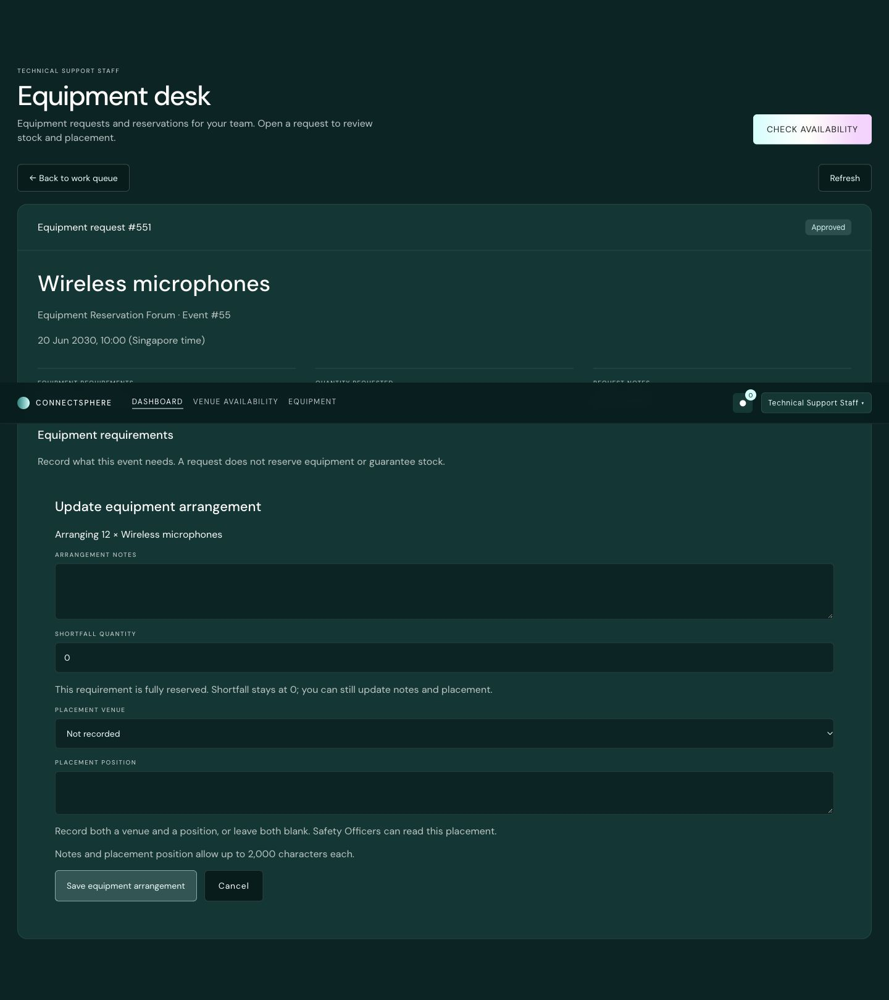
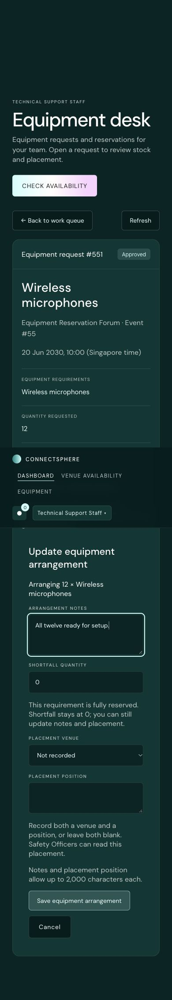

# SG2-55 — Reserve equipment for an event

Technical Support Staff can reserve the full quantity of a pending equipment
request for an approved, planning or confirmed event with an assigned Event
Coordinator. The form shows the quantity and Singapore-time period before
submission. A successful reservation appears in the event's equipment panel and
creates an in-app notification for its assigned coordinator.

## Stock and transaction rules

The database checks current stock while holding the equipment row lock. It
commits the receipt, approves the request, sets its shortfall to zero and inserts
the coordinator notification in one transaction. The request version advances;
existing placement and arrangement notes are preserved. Replays or concurrent
submissions cannot create a second receipt for that request or duplicate its
notice. No partial quantity or client quantity override is accepted.

The stock check uses the peak simultaneous committed quantity over half-open
intervals: an existing reservation ending exactly when the new one begins does
not overlap. Damaged and maintenance equipment contribute no available stock.
Active undated legacy reservations use their confirmed-booking envelope, or
count throughout the proposed period when no complete period is known. Completed,
cancelled and rejected events no longer consume stock.

The commit check includes reservations already held by this same event. This is
deliberately stricter than the [SG2-54 advisory check](equipment-availability.md),
which excludes the event's own commitments when showing what it can use. A new
request for the same equipment consumes additional stock; a previous legacy
receipt does not make that stock free again. Availability is checked again at
submission, so an earlier successful check is not a guarantee.

Insufficient stock, a stale request, an existing receipt or a closed event is
refused without partial changes. A lost response or HTTP 5xx requires refreshing
reservations and requirements before another attempt: the transaction may
already have committed.

## Dates, receipts and continued arrangement

Suggested dates come from SG2-54's request or confirmed-booking period. Otherwise
the form offers the proposed start and requires an explicit end. Inputs preserve
seconds and milliseconds. Finer source precision is expanded outwards to whole
milliseconds, with a visible notice, so the suggested reservation still covers
the complete original period. The API accepts zoned ISO timestamps at up to
millisecond precision and requires a finite end after the start.

Event Coordinators can read receipts for their assigned events. Technical Support
Staff and Safety Officers use the existing equipment-requirement visibility
rules. Receipts show equipment, quantity, period and reservation time; historical
unknown timestamps remain explicitly unrecorded. Only Technical Support can
reserve, and the server supplies that capability to the interface.

Reservation freezes the approved request's demand. Technical Support can still
edit its arrangement and placement while the event is approved or planning,
provided an actual reservation receipt links to that request. Unlinked legacy
approved requests remain closed. Reserved requests remain in the active support
queue so this work can be completed. Event confirmation continues to close
arrangement editing.

After a full reservation, shortfall remains zero. The form locks that field
while allowing notes and placement edits; the database also rejects a positive
shortfall without changing the request, its version, receipt or notification.

## API and deployment

- `GET /api/equipment-reservations?event_id=<id>` reads event receipts and
  `can_reserve` with the existing `equipment_requirements.read` permission.
- `POST /api/equipment-requests/:requestId/reservation` accepts `event_id`,
  `version`, `starts_at` and `ends_at`; it requires
  `equipment.reservations.manage`, granted to Technical Support. Success is 201
  with the updated receipt view and `coordinator_notified: true`. Invalid input
  is 400, lost access is 401/403, inaccessible records are 404 and refused current
  state or stock is 409.

The caller's JWT reaches the guarded
`manage_equipment_reservations(text,integer,bigint,bigint,timestamptz,timestamptz)`
RPC. Its stored-role, event-visibility and version checks remain authoritative.
It uses an empty search path; ordinary clients gain no direct reservation-table
or sequence access.

Apply `supabase/migrations/202610140001_equipment_reservations.sql` once, after
its prerequisite migrations, then apply
`supabase/migrations/202610140002_equipment_reserved_shortfall.sql` before
deploying the edge-case follow-up. The original migration adds request-linked
receipts and notification references, replaces
the guarded requirements RPC to support continued arrangement, and updates the
support queue. Existing receipt rows are retained. Missing hosted RPCs are
reported as an unavailable service; a preview build does not establish that the
migration has been applied.

The follow-up migration replaces only the guarded requirements RPC to reject
nonzero shortfall on reserved requests. Sites that already applied `140001`
must run `140002`; do not replay or edit the original migration. For a site
with equipment records and legacy RLS already installed but no equipment RPCs,
the equipment prerequisite order is `202610080001` (requirements),
`202610120001` (availability), `202610140001` (reservations), then `202610140002`.
The event-status vocabulary migration `202610090001` must be committed
separately first if its four enum values are absent. This does not require the
unrelated event-status backfill.

No new environment variables, paid service, subscription or Supabase plan change
is required. Keep the existing Free plan. A rollback must preserve committed
receipts and compatibility with `equipment_reserved` notifications.

## Verification

`e2e/equipment-reservations.spec.ts` contains five focused journeys:

| Case | Observable result |
| --- | --- |
| SG2-55-P01 | Reserve 12 of 20, reduce another event's remaining stock to 8, finish placement after reloading, then show the coordinator's receipt and notification; 1440px layout and browser error checks. |
| SG2-55-B01 | At 390px, reject equal endpoints without a receipt, accept a complete period and retain the exact dates without horizontal overflow. |
| SG2-55-C01 | A competing reservation after the advisory check causes a refusal; the losing request stays pending and refresh shows the reduced stock. |
| SG2-55-C02 | Rapid clicks send one request, and an API replay leaves one receipt and one notification. |
| SG2-55-N01 | Deny unsigned/coordinator writes; simulate commit followed by HTTP 503, then recover the sole receipt through refresh without duplicate notification. |

Run the build and application coverage checks with `npm run ci`, and browser
journeys with `npm run test:e2e` after the build. The browser fixtures exercise
the real rendered UI and Express routes with disposable memory storage; they
do not prove hosted database behavior. `supabase/tests/equipment_reservations.sql`
and `.github/scripts/test-equipment-reservations-concurrency.mjs` exercise the
actual SQL and independent database sessions in disposable PostgreSQL.

The scenario register is [regression-cases.json](regression-cases.json); detailed
method mapping is [test-case-inventory.json](test-case-inventory.json). Execution
fields must cite a matching completed run. Hosted migration verification and
independent teammate approval remain separate release requirements.

### Local validation — 11 October 2026

The final build passed with 1,295 backend and 1,189 frontend test cases and
100% statement, branch, function and line coverage on every measured file.
All 81 browser journeys and 13 report-gate checks passed. Disposable native
PostgreSQL accepted all 32 migrations, 24 SQL suites (including 46 SG2-55
contracts), and all 22 concurrency scenarios across five scripts.

In-app browser checks at 1440×1000 and 390×844 verified the saved receipt,
immediate approved badge, reduced stock and refusal, and assigned-coordinator
notification. Both widths had no horizontal overflow; no warning/error console
entries appeared in the final visual session. The local fixture is separate from
hosted Supabase, whose migration and deployed workflow remain unverified.

### SG2-55 edge cases — 11 October 2026

The follow-up to PR #77 addresses Elroy's review: a full reservation must keep
shortfall at zero while notes and placement remain editable. It also aligns the
equipment sections with the detail card's desktop and mobile padding. The
existing authorization delegation and lock order remain unchanged.

Local `npm run ci` passed with 1,314 backend and 1,203 frontend cases, 100%
per-file coverage in all four metrics, nine inventory checks and 19 reviewer
checks. All 81 browser journeys and 13 report-gate checks passed. Native
PostgreSQL 17 accepted 33 migrations and all 24 SQL suites, including 47 SG2-55
contracts, and passed all eight SG2-55 concurrency scenarios. The new native
shortfall regression failed before the fix and passed afterward.

In-app visual checks at 1440×1000 and 390×844 verified the disabled zero
shortfall, editable notes/placement, saved placement and preserved receipt.
Neither viewport overflowed horizontally; no warning/error console entries
were recorded. These full visual workflows used disposable local fixtures.

On the hosted Team2-SPM Supabase project, the missing event-status vocabulary
was applied and committed separately, then equipment requirements, availability,
reservations and the shortfall follow-up were applied in one transaction after
a successful rollback rehearsal. Migration history records all five versions.
A rollback-only hosted RPC test verified the receipt and notification, rejection
of shortfall 1 without any row/version change, successful zero-shortfall
placement, and assigned-coordinator reads. Postchecks found all four existing
events and three notifications unchanged, identical queue identities, and no
test equipment, requests or reservations left behind. Supabase remains Free.
The signed-in hosted preview dashboard and equipment catalogue loaded before
and after deployment; full reservation visual acceptance used the isolated
fixture because the hosted catalogue contains no stock.

The new PR still requires green current-head hosted CI/preview and independent
teammate approval before merge; prior review of PR #77 is not approval of this
follow-up.

## SG2-56: release equipment when an event is cancelled

Migration `202610210001_equipment_release.sql` adds `released_at`,
`released_by` and `release_reason` to `equipment_reservations`, and a trigger
on `events` that runs when an event's status moves into `cancelled`:

- **AC1**: every reservation the event still holds is released in the same
  transaction as the cancellation. Whatever cancels the event only has to set
  the status. SG2-67's `cancel_event()` is not built yet, so
  `supabase/tests/equipment_release.sql` stands in for it by cancelling as the
  assigned coordinator.
- **AC2**: no new stock rule. `check_equipment_availability()` and
  `manage_equipment_reservations()` already skip reservations of cancelled
  events and count only operational stock, less anything still committed to
  other events in the period. Damaged equipment and equipment under
  maintenance stay at 0.
- **AC3**: each released reservation keeps who released it (the canceller),
  when, and the reason `Event cancelled`. The event's history gets one
  "Equipment Reservation" entry per reservation, for example
  `Reserved: 6 × Microphones (reservation 12)` →
  `Released: 6 × Microphones (reservation 12) — Event cancelled`.

The trigger function is `security definer` with an empty `search_path`, and
no client role can execute it. Authenticated callers still have no direct
access to `equipment_reservations`. A status change into Cancelled releases
equipment once: later updates to a cancelled event add nothing.
